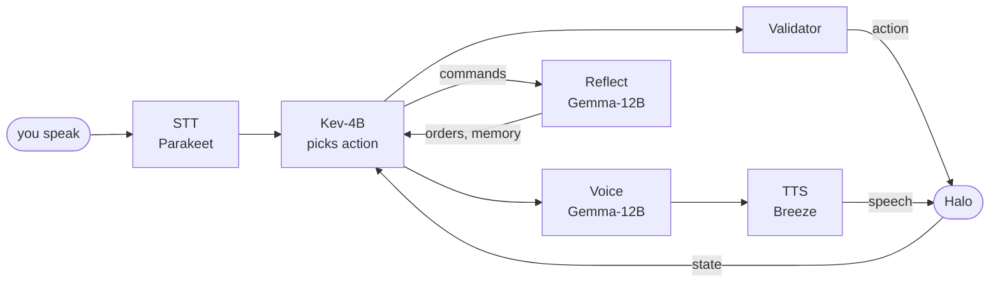

# dude

**Kevin**: an AI teammate who talks and fights beside you in Halo CE. A Python port of
[chasmlol/m8](https://github.com/chasmlol/m8); every model runs locally on one RTX 3090 Ti and the
game runs in a browser.



- **Kev** picks Kevin's action and target from what the game offers; the **Validator** sends it
  and watches the game until it is done or has failed.
- **Voice** writes Kevin's reply (none for filler like "uh"); he starts talking ~1.9 s after you stop.
- **Reflect** keeps your standing orders and facts about you, and pauses while Kevin talks.

**Status:** conversation works; following instructions doesn't yet ([findings §10](docs/findings.md)).

## Run

```bash
# play, on the Mac; then open http://localhost:8000/?m8=ws://100.126.232.8:8091/game
cd ~/halo-m8-web && python3 web_serve.py
# models + m8py, on b650s in ~/m8work/scripts (copies of infra/b650s)
./start-stack-gemma.sh && ./restart-m8py.sh
# develop without a GPU: mock servers, then the brain page at http://127.0.0.1:8090
uv sync
uv run python -m m8py.mocks &
uv run m8py run configs/mock.toml
```

`m8py/` the companion · `games/halo/` the game patch · `infra/b650s/` launch scripts ·
`tools/` log analysis · `docs/` findings and design. Each run logs to `logs/<session>/`;
read one with `uv run python tools/timeline.py logs/<session>`.
