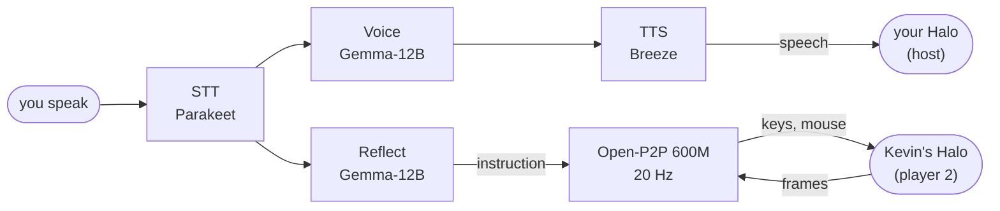

# dude

**Kevin**: an AI teammate who talks and fights beside you in Halo CE. A Python port of
[chasmlol/m8](https://github.com/chasmlol/m8); every model runs locally on one RTX 3090 Ti. You
host co-op in a browser and Kevin joins as player 2 in his own copy of the game, with the same
keyboard and mouse as you.



- **Voice** answers what you say (not filler like "uh"); first words ~1.9 s after you stop.
- **Reflect** keeps your standing orders and facts about you, and turns them into one short
  instruction ("follow the player") about 1 s after you speak.
- **Open-P2P** plays Kevin from his screen, following that instruction.

**Status:** co-op and conversation work; Open-P2P has never seen Halo, so expect rough play
([findings §10](docs/findings.md), [zero-shot test](docs/reports/p2p-halo-zero-shot.md)).

## Run

```bash
# b650s, in ~/m8work/scripts: models + Open-P2P, then m8py in co-op mode
./start-stack-coop.sh && M8PY_CONFIG=configs/b650s-coop.toml ./restart-m8py.sh
# Mac: serve the game, open the URL below (a10 ... d40), click Play; Kevin joins by himself
cd ~/halo-m8-web && python3 web_serve.py
#   http://localhost:8000/?m8=ws://100.126.232.8:8091/game&set=HALO_COOP_HOST=a30
```

The older single-player mode (Kev-4B picks scripted actions for an AI Kevin) is
`./start-stack-gemma.sh` with `configs/b650s.toml`. `m8py/` the companion · `games/halo/` the game
patch · `tools/p2p/` the Open-P2P client · `infra/b650s/` launch scripts · `docs/` findings. Each
run logs to `logs/<session>/`; read one with `uv run python tools/timeline.py logs/<session>`.
