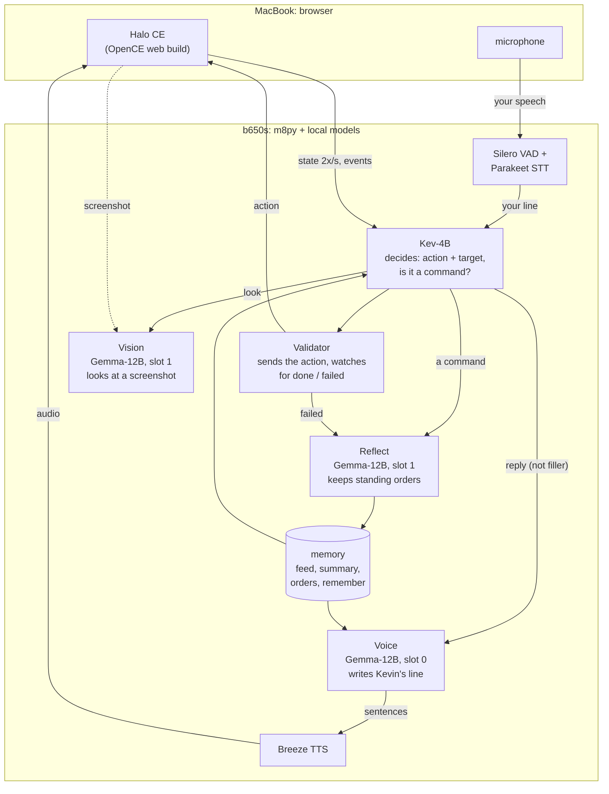

# dude

An AI teammate you can talk to while you play. **Kevin** is a foul-mouthed Spartan who fights
beside you in Halo: Combat Evolved: he hears you, answers in his own voice, and acts in the game
(follows, shoots, holds fire, takes cover, goes where you point).

It started as a Python port of [chasmlol/m8](https://github.com/chasmlol/m8) (`m8py`) and is now
the testbed for a general game-companion architecture. All the models run locally on one
RTX 3090 Ti (22.3 of 23 GB); the game runs in a browser.

## How Kevin works



One turn, when you say "Kevin, hold your fire":

1. **Hear.** The voice-activity detector cuts your speech into a clip; Parakeet transcribes it
   (~80 ms, biased toward the word "Kevin").
2. **Decide.** Kev-4B, a small decision model, reads the situation (Kevin's persona, the game
   state in words, recent lines, standing orders) and in one call picks an action and target
   from what the game offers, and says whether your line is a command (~0.4 s).
3. **Act.** The validator sends the action to the game and watches the game state until it is
   done or has failed.
4. **Talk.** Unless your line was filler ("uh", "yeah") or cut off mid-sentence, Gemma writes
   Kevin's reply, told what he is actually doing; Breeze speaks it sentence by sentence.
   Speech end to first audio: median 1.9 s.
5. **Remember.** For commands, failed actions and every 15 s while orders exist, Reflect (Gemma
   with a short reasoning budget) rewrites the list of standing orders and facts about you.
   It pauses whenever Kevin speaks or looks.

Starting a level from the launcher wipes Kevin's memory.

## Where it stands

Conversation is good: quick, in character, reacts to the fight. **Following instructions is
not reliable yet**: Kev picks among ~19 options with low confidence, every new utterance can
override the action in progress, there is no action for "get behind that rock" or "clear the area
ahead", and Reflect has not yet stored a player's order. Measured details and the open problem
list are in [`docs/findings.md`](docs/findings.md) (latest: §10).

## Run it

**Play** (models already running on b650s): on the Mac, serve the game with your own Xbox `maps/`
folder beside it, then open the launcher and pick a level.

```bash
cd ~/halo-m8-web && python3 web_serve.py
```

Open `http://localhost:8000/?m8=ws://100.126.232.8:8091/game`, turn the microphone on once, and
click a level.

**Start the stack** on b650s (from `~/m8work/scripts`, copies of [`infra/b650s/`](infra/b650s/)):

```bash
./start-stack-gemma.sh
```

```bash
./restart-m8py.sh
```

**Develop without a GPU**, against mock model servers (Python 3.12 via `uv`):

```bash
uv sync && uv run python -m m8py.mocks
```

```bash
uv run m8py run configs/mock.toml
```

The brain page at `http://127.0.0.1:8090` shows what Kevin hears, decides and says, and has
Talk and Event boxes that work with no game connected. Tests: `uv run pytest`.

Every run logs to `logs/<session>/`: `trace.jsonl` (every model request and answer), `spans.jsonl`
(per-turn latency), `gpu.jsonl`, the mic clips and what Kevin saw. To read a session:

```bash
uv run python tools/analyze_session.py logs/<session>
```

```bash
uv run python tools/timeline.py logs/<session>
```

## What's where

| Path | What |
|---|---|
| `m8py/` | the companion: brain loop (`brain.py`), validator, voice, ears, STT server, game link |
| `personas/`, `configs/` | Kevin's prompts and level stories; server and mic settings |
| `games/halo/` | the OpenCE patch: game state for Kevin, actions, WebSocket link, level launcher |
| `infra/b650s/` | launch scripts for the model servers and m8py |
| `tools/` | session analysis and the evaluations behind the findings |
| `docs/findings.md` | what was measured in each playtest, and the open problems |
| `docs/problems.md`, `docs/general-architecture.md` | the problem list and the general companion design |
| `docs/m8-architecture.md`, `docs/port-spec.md` | how the original m8 works, and the port's spec |
